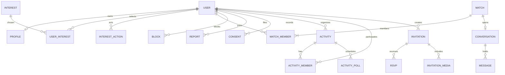

# ERD 논리 모델 (SQL 실행 스키마 아님)

## 데이터·제약·수명주기
- `USER`: id UUID PK, auth_id UNIQUE, account_status, adult_verified_at, adult_verification_expires_at(nullable); 실제 개인정보 최소화.
- `PROFILE`: user_id UNIQUE FK, nickname, bio, photo_visibility, profile_status.
- `INTEREST`: id PK, category, label, status; `USER_INTEREST`: (user_id, interest_id) UNIQUE.
- `INTEREST_ACTION`: actor_id, target_id, decision(yes/no), created_at, UNIQUE(actor_id,target_id); 자기 자신 대상 거부.
- `MATCH`: id, status, created_at; `MATCH_MEMBER`: (match_id,user_id) UNIQUE, 1개 match 2명만 허용 **트랜잭션/제약**.
- `CONVERSATION`: id, match_id UNIQUE; `MESSAGE`: id, conversation_id, sender_id, body, created_at, soft_delete_state.
- `BLOCK`: (blocker_user_id, blocked_user_id) UNIQUE, blocked_at; `REPORT`: reporter_id, reported_user_id, category, description, status, moderator_id(optional).
- `CONSENT`: user_id, consent_type, version, accepted_at, revoked_at; 성인 검증 기록은 동의 기록과 별개.
- `ACTIVITY` (MVP2): organizer_id, title, category, place_display, event_time, privacy, status.
- `ACTIVITY_MEMBER` (MVP2): activity_id, user_id, request_state, UNIQUE(activity_id,user_id).
- `ACTIVITY_POLL` (MVP2): activity_id, options (별도 정규화 권장), closes_at, status.
- `INVITATION` (MVP3): owner_id, title, wedding_date, venue, sharing_token_hash, visibility, expiry, theme_id, status.
- `RSVP` (MVP3): invitation_id, guest_private_token_hash, response, party_size, note, responded_at; 공개 링크 열람자는 명단 접근 불가.
- `INVITATION_MEDIA` (MVP3): invitation_id, private_blob_path, order, consent_record_id.

**보안:** 개인 프로필/메시지/게스트 응답은 테이블별 RLS default deny, 서버/관리자 최소권한, 로그에는 메시지 원문 금지. 실제 SQL은 리뷰된 migration과 정책/테스트로 별도 구현.
