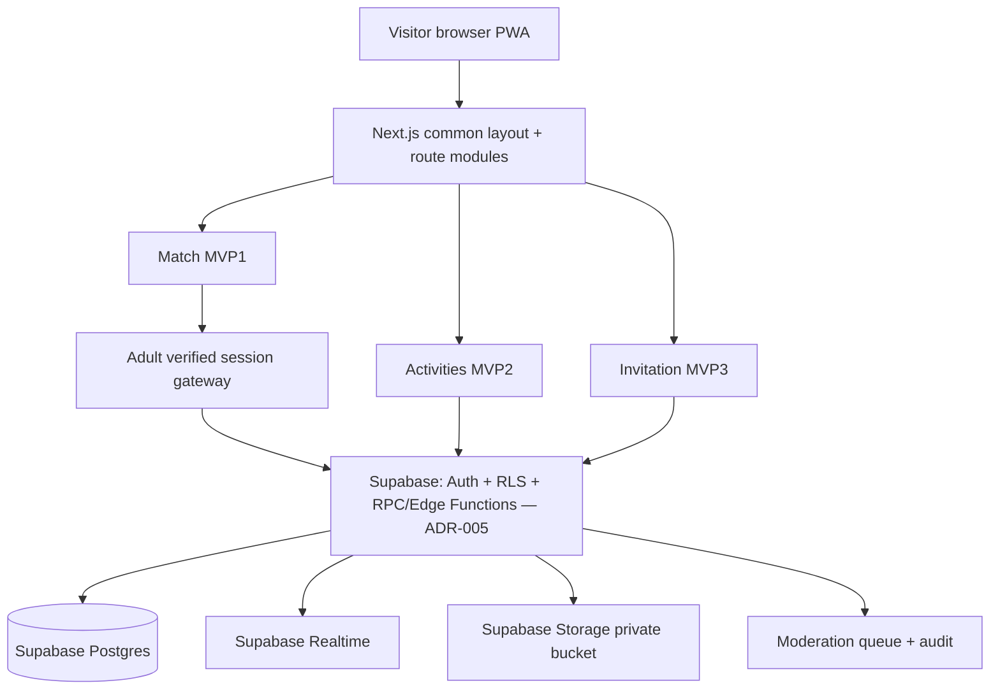

# 시스템 구성 및 설계 결정 기록 (ADR)

## ADR-001 단일 서비스, 모듈형 모놀리스
- 단일 Next.js App Router 프런트/백엔드+BaaS(PostgreSQL/Auth/Realtime) 후보.
- `/`, `/match`, `/activities`, `/invitations`는 공통 shell을 공유; 각 모듈의 DB 도메인은 `match_*`, `activity_*`, `invite_*` 또는 명확한 스키마 식별자로 구분.
- 공통 `user_profile`, `consent`, `block`, `report`, `audit_log`는 재사용 가능하지만 **서로 다른 모듈 데이터 열람 권한은 분리**.
- 초기에 모놀리스로 개발하고 운영 규모가 확인되면 이벤트/알림을 별도 워커로 분리.

## ADR-002 개인정보/성인 검증 경계
- 검증 사업자 선택 전 더미 성인 인증은 **로컬/자동테스트만**, 공개 배포에서는 fail-closed.
- DOB/신분증·주민번호 원본은 저장하지 않음. 필요한 최소 인증 결과·만료 시각만 저장하는 구조 검토.
- 추천/좋아요/대화/RLS 등 모든 진입점에서 검증 재확인. 클라이언트 조건은 UI 편의용.

## ADR-003 Realtime 및 차단
- 매칭 동의로 conversation 1건 생성; 메시지 구독 권한은 단순 룸 ID가 아니라 활성 match 멤버십으로 검사.
- block 상태 변경 시 권한 회수: DB RLS+서버 이벤트 체크, 이미 열린 실시간 연결의 강제 해제/재검증 설계.
- 삭제 계정/차단 계정의 추천 캐시 무효화, 신고는 별도 운영자 최소권한.

## ADR-004 이벤트/청첩장 확장
- 2차 모임(`activities`)은 위치를 기본값으로 저장하지 않으며 수동 선택 가능. 백그라운드 GPS 위치추적을 전제하지 않음.
- 3차 `invitations`의 공개 링크는 불규칙 토큰, 검색엔진 미노출을 기본으로 검토; RSVP 데이터는 호스트/해당 게스트 외 기본 비공개.
- 초대장은 매칭 성공 사용자에게만 제한하지 않음. 서비스 모듈 중 독립 유입과 공유를 지원.

## ADR-005 백엔드: Supabase + GitHub Pages 정적 배포 (2026-10-27 확정, 김민기)
- **결정**: 프런트는 지금처럼 GitHub Pages 정적 export(`output: 'export'`, `basePath: /eottae`)로 배포하고, 백엔드는 **Supabase**(Auth · Postgres+RLS · Realtime · Storage · Edge Functions)를 브라우저에서 `@supabase/supabase-js`로 직접 호출한다.
- **이유**: Pages는 정적 호스팅이라 Next.js API 라우트(`src/app/api/**`)가 배포 환경에서 실행되지 않는다(빌드 시 정적 파일로만 남는다). Supabase는 ADR-001의 "BaaS(PostgreSQL/Auth/Realtime)" 후보와 일치하고, 기존 ERD·`supabase/` 폴더를 그대로 살릴 수 있으며, 배포 파이프라인을 바꾸지 않아도 된다. 검토한 대안은 Firebase(설계 문서 전부 재작성 필요)와 Vercel 이전(배포 교체 + DB 별도 필요)이다.
- **보안 경계 = RLS**: 클라이언트 조건은 UI 편의일 뿐이다(ADR-002). 모든 테이블은 RLS를 켜고 default deny로 시작해, 정책이 허용한 행만 접근하게 한다.
  - 브라우저에는 **공개 키(Publishable key, 옛 이름 anon key)만** 들어간다. 공개돼도 되는 값이지만, **service_role(secret) key는 프런트 코드·Git·GitHub Pages 빌드 어디에도 넣지 않는다**(클라우드 Edge Function에는 `SUPABASE_SERVICE_ROLE_KEY`로 자동 제공되므로 복사할 일도 없다). Edge Function은 로그인한 사용자의 access token(JWT)으로 호출되므로 기본 `verify_jwt`를 유지한다.
  - **로그인/세션 (MATCH-003)**: Supabase Auth를 그대로 사용한다. 자체 세션 토큰·서명은 만들지 않는다. 만료와 로그아웃은 Auth가 처리하고, RLS는 `auth.uid()`로 본인을 판정한다.
  - **성인 인증 (MATCH-004)**: 인증 결과(`adult_verified`, 만료 시각)는 **Edge Function만 쓸 수 있는 컬럼**에 기록한다. 클라이언트 update는 RLS로 막는다. 인증 업체 확정 전 더미 인증은 로컬 Supabase에서만 허용하고, 공개 프로젝트에서는 fail-closed로 둔다. 매칭·채팅 관련 RLS는 모두 "검증된 성인 + ACTIVE 계정" 조건을 포함한다.
  - **관심·상호 매칭 (MATCH-005)**: 좋아요 insert는 본인 행만 허용한다. 쌍방 성립 시 match·conversation 생성은 `security definer` RPC나 트리거가 1건만 만들고(UNIQUE 제약), 클라이언트는 match 테이블에 직접 insert하지 못한다.
  - **추천 필터 (MATCH-006)**: 본인·차단·탈퇴·휴면·미성년 제외는 RLS가 적용되는 view나 RPC에서 처리한다.
  - **채팅 (MATCH-007)**: 메시지 select/insert는 "활성 match 구성원이고 서로 차단하지 않은 경우"만 허용한다. Realtime은 RLS가 적용되는 채널(postgres_changes 또는 private channel 권한 정책)로 구독하므로, 차단 즉시 송수신이 멈춘다(ADR-003).
  - **신고·차단 (MATCH-008)**: 신고는 본인 insert만 허용하고 조회는 운영자 역할만 할 수 있다(일반 계정 403에 해당).
  - **계정 삭제 (CORE-004)**: 사용자 삭제(auth.users)는 service_role이 필요하므로 Edge Function으로 처리하고, 보존 예외 데이터 정책을 함께 적용한다.
- **배포 설정**: GitHub 저장소 Secrets `NEXT_PUBLIC_SUPABASE_URL`, `NEXT_PUBLIC_SUPABASE_ANON_KEY`를 `deploy-pages.yml`의 build 단계에 주입한다. 값이 없으면 빈 문자열로 빌드되며, 화면은 데모 데이터 모드로 동작해야 한다(키가 없어서 빌드가 깨지지 않게).
- **API 계약과의 관계**: `API_계약_초안.md`의 `/api/v1/...` 경로는 **논리 계약**으로 유지하고, 실제 구현은 테이블+RLS / RPC / Edge Function으로 대응한다(대응표는 API 계약 문서 하단). `src/app/api/health`처럼 정적으로 둘 수 있는 것 외에는 Next API 라우트를 새로 만들지 않는다.
- **마이그레이션**: `supabase/migrations/`에 Supabase CLI 형식으로 작성한다. 되돌릴 수 있게 만들고, RLS 정책마다 허용·거부 테스트(TC-003~010)를 같이 둔다. 운영 DB에 AI 에이전트나 MCP를 직접 연결하지 않는다(운영 결정 목록 유지).
- **프로젝트 소유·키 관리 (2026-10-27 추가)**: Supabase 조직·프로젝트는 **김민기가 만들고 Owner로 소유**한다. 키를 한 사람이 관리해 팀원끼리 키를 주고받지 않게 하고, 팀원 계정 사정으로 프로젝트 접근을 잃지 않게 하기 위해서다. 주한태(DB·RLS 담당)는 조직에 **Developer**로 초대받아 스키마·정책을 작업한다.
  - 지역 **Northeast Asia (Seoul)**, 무료 플랜. 무료 플랜은 1주일간 사용이 없으면 일시 정지되므로 시연 전에 대시보드에서 상태를 확인한다.
  - 값별 보관 위치:

    | 값 | 보관 위치 | 공유 |
    |---|---|---|
    | Project URL · Publishable key(팀 통일) | GitHub Secrets `NEXT_PUBLIC_SUPABASE_URL`·`NEXT_PUBLIC_SUPABASE_ANON_KEY`, 각자 `.env.local` | 팀원 공유 가능(브라우저에 공개되는 값) |
    | service_role(secret) key | 복사하지 않음 — 클라우드 Edge Function에 자동 제공 | **공유·커밋 금지** |
    | 외부 서비스 키(성인 인증 업체 등) | Edge Function 시크릿(`supabase secrets set`)만 | **공유·커밋 금지** |
    | DB 비밀번호 | 김민기 비밀번호 관리자 | **공유 금지** |
  - 마이그레이션 흐름: 주한태는 **로컬 Supabase**(`npx supabase start`, Docker)에서 마이그레이션·RLS 테스트를 만들어 PR로 올린다. 리뷰·머지 후 **김민기가 클라우드 프로젝트에 적용**한다(`npx supabase link --project-ref <ref>` → `npx supabase db push`). 운영 DB 비밀번호를 여러 사람이 갖지 않고, 리뷰를 거친 마이그레이션만 운영에 들어간다.

## 도식

## 운영 결정 목록 (미확정)
- (확정: 백엔드 = Supabase + GitHub Pages, ADR-005)
- 도메인/PG/실명성인 인증 업체·실사용 계정 연동, 배포 지역/이용약관, 데이터 삭제·보존 기한, 이미지 콘텐츠 검수, 베타 운영자 시간.
- 운영 DB에 AI 에이전트/MCP를 연결하거나 외부 저장소 업로드하지 않는다.
