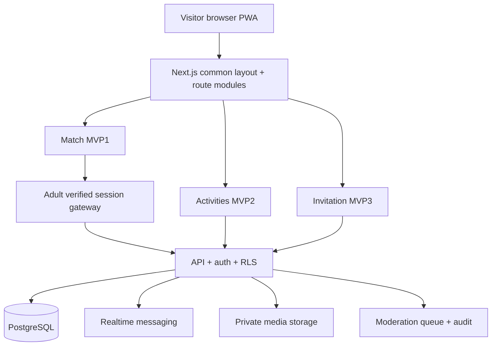

# 시스템 구성 및 설계 결정 기록 (ADR)

## ADR-001 단일 서비스, 모듈형 모놀리스
- 단일 Next.js App Router 프런트/백엔드+BaaS(PostgreSQL/Auth/Realtime) 후보.
- `/`, `/match`, `/activities`, `/invitations`는 공통 shell을 공유; 각 모듈의 DB 도메인은 `match_*`, `activity_*`, `invite_*` 또는 명확한 스키마 식별자로 구분.
- 공통 `user_profile`, `consent`, `block`, `report`, `audit_log`는 재사용 가능하지만 **서로 다른 모듈 데이터 열람 권한은 분리**.
- 초기에 모놀리스로 개발하고 운영 규모가 확인되면 이벤트/알림을 별도 워커로 분리.

## ADR-002 개인정보/성인 검증 경계
- 검증 사업자 선택 전 더미 성인 인증은 **로컬/자동테스트만**, 공개 배포에서는 fail-closed.
- DOB/신분증·주민번호 원본은 저장하지 않음. 필요한 최소 인증 결과·만료 시각만 저장하는 구조 검토.
- 추천/좋아요/대화/RLS 등 모든 진입점에서 검증 재확인. 클라이언트 조건은 UI 편의용.

## ADR-003 Realtime 및 차단
- 매칭 동의로 conversation 1건 생성; 메시지 구독 권한은 단순 룸 ID가 아니라 활성 match 멤버십으로 검사.
- block 상태 변경 시 권한 회수: DB RLS+서버 이벤트 체크, 이미 열린 실시간 연결의 강제 해제/재검증 설계.
- 삭제 계정/차단 계정의 추천 캐시 무효화, 신고는 별도 운영자 최소권한.

## ADR-004 이벤트/청첩장 확장
- 2차 모임(`activities`)은 위치를 기본값으로 저장하지 않으며 수동 선택 가능. 백그라운드 GPS 위치추적을 전제하지 않음.
- 3차 `invitations`의 공개 링크는 불규칙 토큰, 검색엔진 미노출을 기본으로 검토; RSVP 데이터는 호스트/해당 게스트 외 기본 비공개.
- 초대장은 매칭 성공 사용자에게만 제한하지 않음. 서비스 모듈 중 독립 유입과 공유를 지원.

## 도식

## 운영 결정 목록 (미확정)
- 도메인/PG/실명성인 인증 업체·실사용 계정 연동, 배포 지역/이용약관, 데이터 삭제·보존 기한, 이미지 콘텐츠 검수, 베타 운영자 시간.
- 운영 DB에 AI 에이전트/MCP를 연결하거나 외부 저장소 업로드하지 않는다.
